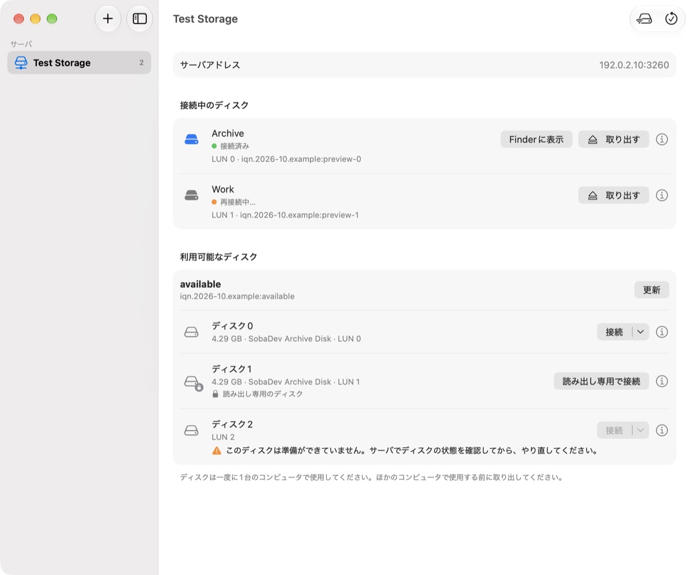

# Kurazuna（蔵綱）

[English](README.md)

Kurazuna（くらづな）は Mac 用の iSCSI イニシエータです。ネットワーク上のディスクを Mac に接続して、Finder やディスクユーティリティで使えます。Apple シリコンの Mac と macOS 27 以降に対応します。

[GitHub Releases](https://github.com/shunnag/Kurazuna/releases/tag/v1.0-beta.1) から **Kurazuna-1.0-beta.1.zip** をダウンロードします。ZIP を開き、初回起動の前にFinderでKurazunaを「アプリケーション」フォルダにドラッグしてください。あとで場所を変えるときは、接続中のディスクを取り出し、Kurazunaを終了してからFinderで移動し、移動先から開きます。別のコピーが登録されていると表示されたら「このコピーを使用」を選びます。有効化を求められた場合は「ファイルシステム機能拡張」でKurazunaをオンにしてください。



ビルド203からアップデートを自動で確認し、ダウンロードします。「Kurazuna」メニューの「アップデートを確認…」からも確認できます。自動更新は設定で変更できます。ビルド202をお使いの場合は、ディスクを取り出してアプリを終了し、この ZIP で一度だけ入れ替えてください。

## ディスクに接続する

1. 初回はアプリの「システム設定を開く」をクリックし、「ファイルシステム機能拡張」で Kurazuna をオンにします。この設定は「一般」＞「ログイン項目と機能拡張」＞「カテゴリ別」からも開けます。
2. 「サーバを追加…」でアドレス（例：`nas.local:3260`）を入力します。サーバが CHAP または相互 CHAP を使う場合は認証情報も入力します。パスワードはキーチェーンに保存されます。
3. 「ディスクを検索」をクリックし、使うディスクの「接続」をクリックします。内容を変更せずに開くときは、接続メニューから「読み出し専用で接続」を選びます。
4. 接続したディスクの「Finder に表示」でファイルを開けます。使い終わったら「取り出す」をクリックします。

同じディスクには一度に1台のコンピュータから接続してください。空のディスクを初期化するには、接続後にディスクユーティリティを開きます。

## 対応するディスク

| ディスク | 接続方法 |
| --- | --- |
| 512 バイト単位の GPT（論理ブロックが 512 または 4096 バイト） | 読み書き、読み出し専用 |
| 4096 バイト単位の GPT（真の 4Kn） | 読み出し専用 |
| GPT のない LUN | 論理ブロックが 512 バイトなら読み書き可能。4096 バイトなら読み出し専用 |

書き込み保護されたディスクは自動的に読み出し専用になります。APFS、ExFAT、ジャーナリング HFS+ で接続を検証しています。独立したターゲットでの試験結果と条件は[相互接続の記録](docs/compatibility.md)にあります。

## 通信が切れたとき

アプリは自動的に再接続し、同じディスクであることを確かめてから読み書きを再開します。書き込みや同期を完了できない場合はエラーを返し、それ以降の書き込みを停止します。「強制的に取り出す」はサーバに保存できていない変更を破棄します。

ビルド202では、5分間の通信断から自動で復旧し、保存したデータがターゲット上で一致することを確認しました。以前の開発版では同じ試験で復旧直後の書き込みが一度失敗し、強制取り出しが必要になりました。原因は調査中です。実 NAS、Mac 本体の電源断、日単位の連続運転は未検証です。検証した条件は[互換性と既知の制限](docs/compatibility.md)にあります。

## 開発

Xcode と XcodeGen を用意し、リポジトリのルートで実行します。

```sh
make build       # 通信ライブラリと CLI
make test        # 単体テスト
make lint        # コードスタイルと C ヘッダの検査
make app-build   # アプリと FSKit 拡張
```

実マウントには署名とファイルシステム機能拡張の有効化が必要です。[開発とテスト](docs/building.md)

## ライセンス

Kurazuna のコードとアイコンは、[MIT License](LICENSE-MIT) と [Apache License 2.0](LICENSE-APACHE) のどちらかを選んで利用できます。コードやアイコンの変更を投稿する場合も、両方の条件での提供をお願いします。個別の表示がある第三者の素材には、その表示に記載された条件が適用されます。
