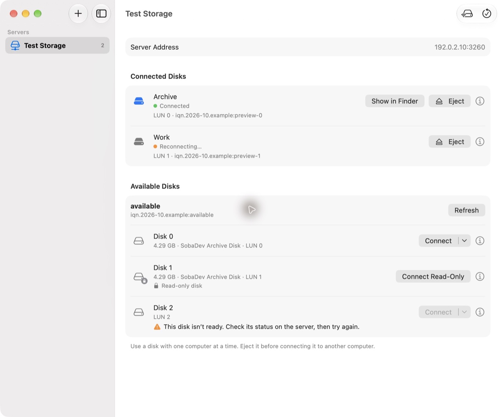

# Kurazuna

[日本語](README.ja.md)

Kurazuna (蔵綱, *kurazuna*) is an iSCSI initiator for Apple silicon Macs running macOS 27 or later. Connect a disk on your storage server and use it in Finder or Disk Utility. The bundled FSKit extension runs in user space.

Download **Kurazuna-1.0-beta.1.zip** from [GitHub Releases](https://github.com/shunnag/Kurazuna/releases/tag/v1.0-beta.1), open the ZIP, then use Finder to drag Kurazuna into Applications before opening it. To move it later, eject connected disks, quit Kurazuna, move the app in Finder, and open it from the new folder. If macOS still selects another copy, click **Use This Copy**. If asked, turn Kurazuna on in **File System Extensions**.

Starting with build 203, Kurazuna automatically checks for and downloads signed updates. Choose **Kurazuna → Check for Updates…** to check now, or change automatic updates in Settings. If you have build 202, eject your disks and quit Kurazuna before replacing the app with this download once.

## Connect a disk

1. Open Kurazuna and click **Open System Settings**. Turn on Kurazuna in **File System Extensions**. You can also reach it from General → Login Items & Extensions → By Category.
2. Choose **Add Server…** and enter the server address, such as `nas.local:3260`. If your server uses CHAP or mutual CHAP, enter its credentials. Kurazuna stores passwords in Keychain.
3. Click **Find Disks**, then **Connect** next to the disk. For read-only access, choose **Connect Read-Only** from the Connect menu.
4. Click **Show in Finder** to open the volume. Click **Eject** when you finish.

Connect a disk to one computer at a time. To format an empty disk after connecting it, use Disk Utility.

## Supported disks

| Disk layout | Access |
| --- | --- |
| GPT in 512-byte units, with 512- or 4096-byte logical blocks | Read/write or read-only |
| GPT in 4096-byte units (native 4Kn) | Read-only |
| LUN without a GPT | Read/write for 512-byte logical blocks, read-only for 4096-byte logical blocks |

A write-protected disk connects read-only. Tested file systems include APFS, ExFAT, and Mac OS Extended (Journaled). See [compatibility and known issues](docs/compatibility.md) for the targets and conditions tested.

## If the connection is interrupted

Kurazuna reconnects and checks the disk’s identity before resuming I/O. If it cannot complete a write or flush, it reports an error and stops further writes. **Force Eject** discards changes that could not be saved to the server.

Build 202 recovered from a five-minute outage and passed a check of the data on the target. An earlier build once reported a write error after reconnecting under the same test condition and required Force Eject. The cause remains under investigation. Testing on physical NAS appliances, abrupt Mac power loss, and multi-day runs is pending.

## Development

Use Xcode with the macOS 27 SDK and XcodeGen. Run `make build`, `make test`, and `make lint` for the Swift package, or `make app-build-release` for the app and its extension. See [building and testing](docs/building.md) for signing and real-target tests.

## License

The original code and icon are available under the [MIT License](LICENSE-MIT) or [Apache License 2.0](LICENSE-APACHE), at your option. By submitting a contribution for inclusion, you agree to offer it under both licenses on the same basis. Third-party materials carrying their own notices follow those terms.
